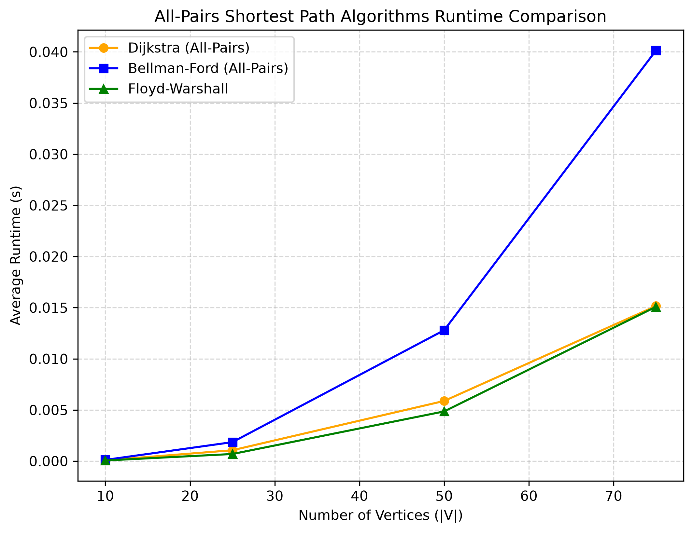
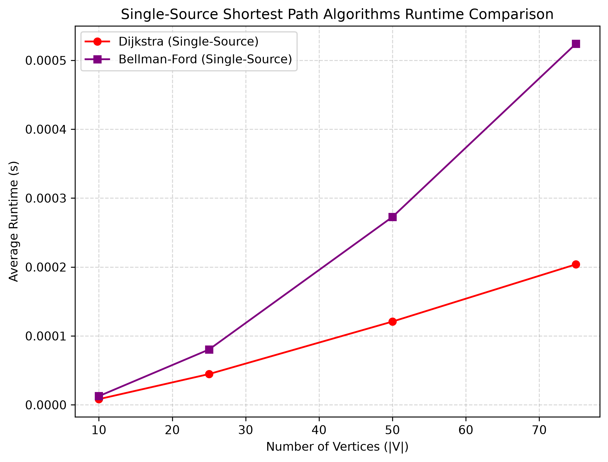

# Graph Shortest Path Algorithms & Empirical Benchmark

A from-scratch Python implementation and runtime analysis of classic **Single-Source** and **All-Pairs Shortest Path** algorithms on weighted random graphs, utilizing a custom **Min Binary Heap** priority queue.

## Implemented Algorithms & Data Structures

1. **Custom Data Structures (`shortest_path.py`):**
   * **Weighted Random Graph (`Graph`):** Adjacency list representation with configurable edge density ($p = 1/3$) and edge weights $\{1, 5, 20\}$.
   * **Min Binary Heap (`MinBiHeap`):** Custom priority queue supporting $O(\log V)$ insertion and minimum extraction without external heap libraries.

2. **Shortest Path Algorithms:**
   * **Dijkstra's Algorithm:** Greedy single-source and all-pairs shortest path solver powered by `MinBiHeap` ($O((V + E) \log V)$ per source).
   * **Bellman-Ford Algorithm:** Dynamic programming approach with early-stopping optimization and negative-weight cycle detection ($O(V \cdot E)$ per source).
   * **Floyd-Warshall Algorithm:** Dynamic programming all-pairs shortest path solver with negative cycle detection ($O(V^3)$).

---

## Experimental Results

Benchmarks were conducted on Erdős–Rényi random weighted graphs ($|V| \in \{10, 25, 50, 75\}$), averaged over **20 independent trials** per graph size.

### All-Pairs Shortest Path Comparison


### Single-Source Shortest Path Comparison


---

## How to Run

1. Install `matplotlib`:
   ```bash
   pip install matplotlib
